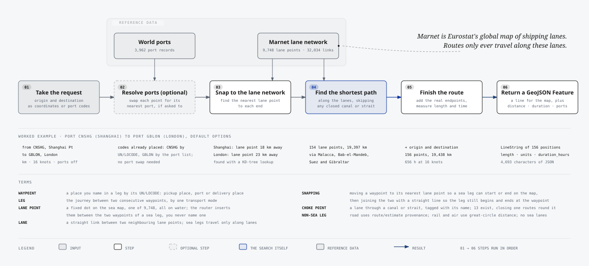
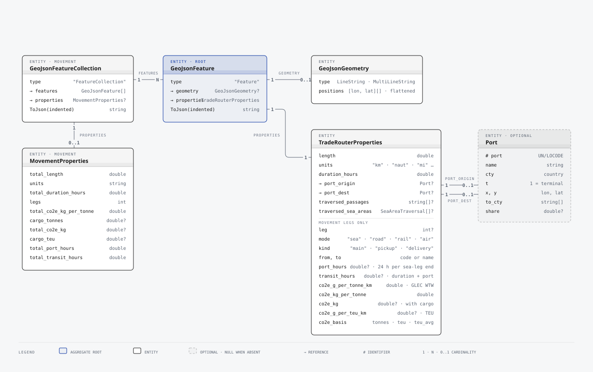
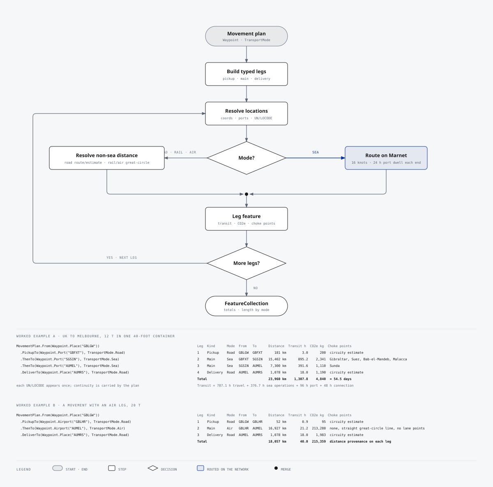

# TradeRouter.Java

[](https://central.sonatype.com/artifact/io.github.skuirrels/traderouter)
[](https://openjdk.org)
[](LICENSE)
[](traderouter/pom.xml)

Shortest sea route between ports identified by UN/LOCODE, as a single self-contained Java library. A port of [TradeRouter.Net](https://github.com/skuirrels/TradeRouter.Net) 2.2.0 that embeds the same data and produces the same routes, GeoJSON and reports.

Give it two UN/LOCODE port codes and it returns RFC 7946 GeoJSON with the distance, voyage duration, ports used and canals and straits passed through. Port codes are the native input; raw coordinates remain available as a fallback for custom or unresolved locations. Ordinary routes are `LineString`; antimeridian crossings are split into `MultiLineString`. The maritime network and world ports database are compressed and embedded in the jar, so there is nothing to download, configure or host.

```java
import io.github.skuirrels.traderouter.TradeRouterOptions;
import io.github.skuirrels.traderouter.TradeRoutes;

var route = TradeRoutes.calculate(
    "FRMRS", // Marseille
    "ZACPT", // Cape Town
    new TradeRouterOptions().setAppendOriginDestination(true));

System.out.printf("%,.0f %s, %,.0f h%n",
    route.properties().getLength(), route.properties().getUnits(), route.properties().getDurationHours());
// 11,000 km, 371 h
```

### Complete multi-leg movement

Route pickup, two sea legs and final delivery using UN/LOCODEs throughout. The result contains every leg, totals, a modelled minimum time, emissions, choke points and a GeoJSON `FeatureCollection`. `setReturnSeaAreas(true)` in the sea options adds the sea areas each sea leg crosses to that leg's GeoJSON properties; `toText()` does not list them.

```java
import io.github.skuirrels.traderouter.TradeRouterOptions;
import io.github.skuirrels.traderouter.TradeRoutes;
import io.github.skuirrels.traderouter.movements.MovementPlan;
import io.github.skuirrels.traderouter.movements.TransportMode;
import io.github.skuirrels.traderouter.movements.Waypoint;

var plan = MovementPlan
    .from(Waypoint.place("GBLGW"))
    .pickupTo(Waypoint.port("GBFXT"), TransportMode.ROAD)
    .thenTo(Waypoint.port("SGSIN"), TransportMode.SEA)
    .thenTo(Waypoint.port("AUMEL"), TransportMode.SEA)
    .deliverTo(Waypoint.place("AUMRS"), TransportMode.ROAD);

var movement = TradeRoutes.calculateMovement(
    plan,
    new TradeRouterOptions().setReturnPassages(true).setReturnSeaAreas(true),
    12.0, // Optional cargo tonnes: gross weight, used on inland legs when above 10 t per TEU
    2.0); // Optional cargo TEU: one 40-foot container, charged per TEU at sea and at least 10 t per TEU inland

System.out.println(movement.toText());
String geoJson = movement.toJson(true);
```

Both cargo measurements are shown together only to demonstrate the two emissions bases; real callers can provide either measurement, both when reliably known, or neither (pass `null`). When both are supplied, sea legs use TEU in preference to tonnes, road and rail legs use the greater of the stated tonnes and 10 t per TEU, and air legs use the stated tonnes. `toText()` produces the full end-to-end report directly from the calculated movement; `toJson()` returns the same movement as GeoJSON for mapping or downstream processing. The time is labelled **modelled minimum** because it is built from documented assumptions rather than a live carrier schedule.

```text
Leg Kind      Mode  From   To      Distance       Distance basis   Modelled transit time       CO2e rate  CO2e per tonne  CO2e total               Basis  Choke points
                                                                                   hours      g per t-km  kg per t cargo          kg
1   Pickup    Road  GBLGW  GBFXT        183 km   circuity_estimate                     3.0           125.0            22.9         457  teu_average_weight
2   Main      Sea   GBFXT  SGSIN     15,402 km    maritime_network                   895.2             7.2           110.4       2,209                 teu  Gibraltar, Suez, Bab-el-Mandeb, Malacca
3   Main      Sea   SGSIN  AUMEL      7,300 km    maritime_network                   391.6             7.2            52.3       1,047                 teu  Sunda
4   Delivery  Road  AUMEL  AUMRS      1,011 km   circuity_estimate                    16.8           125.0           126.4       2,527  teu_average_weight
Total                                23,896 km                                     1,306.7                           312.0       6,240                      for 12 t of cargo in 2 TEU
Modelled minimum = 786.0 h travel + 376.7 h sea operations + 96 h port handling + 48 h connections = 1,306.7 h (54.4 days)
Distance basis = maritime_network/road_network are network routes; circuity_estimate is a planning estimate; great_circle is straight-line
Timing         = planning lower bound from configured assumptions; excludes carrier schedules, customs and disruption
CO2e rate      = grams of CO2e emitted moving 1 tonne 1 km (configured factor for the mode)
CO2e per tonne = rate × leg distance: kg of CO2e for each tonne of cargo carried over the leg
CO2e total     = kg of CO2e for this shipment: 71.7 g per TEU-km on sea legs, the greater of cargo weight and 10 t per TEU on road and rail legs, cargo weight on air legs
```

### Sea and rail movement

Ship a heavy 40-foot container from Shanghai to Hamburg, forward it by rail to Prague and deliver it by road to Plzeň. A rail leg's endpoints must be UN/LOCODEs recorded as rail terminals or multimodal facilities; `Waypoint.station` declares the rail role and the plan is rejected if the code list disagrees. [Rail routing](#rail-routing) covers under-recorded terminals and supplied track distances.

```java
var plan = MovementPlan
    .from(Waypoint.port("CNSHG"))
    .thenTo(Waypoint.port("DEHAM"), TransportMode.SEA)
    .thenTo(Waypoint.station("CZPRG"), TransportMode.RAIL)
    .deliverTo(Waypoint.place("CZPLZ"), TransportMode.ROAD);

var movement = TradeRoutes.calculateMovement(
    plan,
    new TradeRouterOptions().setReturnPassages(true).setReturnSeaAreas(true),
    24.0, // Heavier than 10 t per TEU, so road and rail legs are charged on the stated weight
    2.0);

System.out.println(movement.toText());
```

The container weighs more than the GLEC average of 10 t per TEU, so the rail and road legs report the `tonnes` basis while the sea leg stays per TEU. Hamburg and Prague lie outside the embedded North American rail network, so without a supplied rail route the rail leg keeps great-circle distance at the default 80 km/h and carries a `distance_warning`; its 491 km is a lower bound on the track distance. No handling or connection time is added at the rail terminals; only sea legs carry port dwell and transshipment allowances.

```text
Leg Kind      Mode  From   To      Distance       Distance basis   Modelled transit time       CO2e rate  CO2e per tonne  CO2e total               Basis  Choke points
                                                                                   hours      g per t-km  kg per t cargo          kg
1   Main      Sea   CNSHG  DEHAM     19,991 km    maritime_network                 1,147.7             7.2           143.3       2,867                 teu  Malacca, Bab-el-Mandeb, Suez, Gibraltar
2   Main      Rail  DEHAM  CZPRG        491 km        great_circle                     6.1            30.7            15.1         362              tonnes
3   Delivery  Road  CZPRG  CZPLZ        112 km   circuity_estimate                     1.9           125.0            14.1         337              tonnes
Total                                20,595 km                                     1,155.7                           172.5       3,566                      for 24 t of cargo in 2 TEU
Modelled minimum = 682.7 h travel + 425.0 h sea operations + 48 h port handling + 0 h connections = 1,155.7 h (48.2 days)
Distance basis = maritime_network/road_network are network routes; circuity_estimate is a planning estimate; great_circle is straight-line
Timing         = planning lower bound from configured assumptions; excludes carrier schedules, customs and disruption
CO2e rate      = grams of CO2e emitted moving 1 tonne 1 km (configured factor for the mode)
CO2e per tonne = rate × leg distance: kg of CO2e for each tonne of cargo carried over the leg
CO2e total     = kg of CO2e for this shipment: 71.7 g per TEU-km on sea legs, the greater of cargo weight and 10 t per TEU on road and rail legs, cargo weight on air legs
```

---

## Contents

- [How it works](#how-it-works)
- [What you get back](#what-you-get-back)
- [Installation](#installation)
- [Usage](#usage)
- [Options reference](#options-reference)
- [Performance](#performance)
- [Repository layout](#repository-layout)
- [Building, testing and trying it out](#building-testing-and-trying-it-out)
- [Differences from TradeRouter.Net](#differences-from-traderouternet)
- [Data](#data)
- [Licence](#licence)

---

## How it works

Every request goes through the same six steps, in order. The datasets are decompressed and indexed once on first use, then shared read-only by every thread.

<p align="center">
  
</p>

Source: [docs/diagrams/routing-pipeline.svg](docs/diagrams/routing-pipeline.svg) (vector) and [routing-pipeline.html](docs/diagrams/routing-pipeline.html).

1. **Take the request.** Normally an origin and destination as UN/LOCODE port codes, plus options such as units, vessel speed and closed passages. Coordinates are accepted for custom or unresolved endpoints.
2. **Resolve ports.** The port-code overload resolves each code directly. Coordinate requests only resolve to nearby ports when `includePorts` is set; those ports can be limited by terminal or country.
3. **Snap to the lane network.** Each end is matched to the geographically nearest point on Marnet using a spherical KD-tree, including across the date line and near the poles. Shanghai's port position is 18 km from its lane point, London's 23 km.
4. **Find the shortest path** along the lanes with bidirectional Dijkstra, or A* on request. Lane links through a closed canal or strait are skipped; the Northwest Passage is closed by default. Shanghai to London gives 154 lane points over 19,397 km, through Malacca, Bab-el-Mandeb, Suez and Gibraltar.
5. **Finish the route.** With `appendOriginDestination` the real endpoints are added, and length and duration are measured: 156 points, 19,438 km, 656 hours at 16 knots.
6. **Return a GeoJSON Feature**: a LineString, an antimeridian-split MultiLineString, or null geometry when no path exists, plus distance, units, duration, ports and passages, and the sea areas crossed when `returnSeaAreas` is set.

### Terms

These apply to single routes and to multi-leg movements, which are described [below](#multi-leg-movements).

- **Waypoint**: a place you name in a leg by its UN/LOCODE. Pickup places, ports and delivery places are all waypoints. The first and last waypoints of a movement are the pickup and delivery places.
- **Leg**: the journey between two consecutive waypoints, by one transport mode.
- **Lane point**: a fixed dot on the sea map, one of 9,748, all on water. The router inserts them between the two waypoints of a sea leg; you never name one.
- **Lane**: a straight link between two neighbouring lane points. Sea legs travel only along lanes.
- **Snapping**: moving a waypoint's position to its nearest lane point so a sea leg can start or end on the map, then joining the two with a straight line so the leg still begins and ends at the waypoint.
- **Choke point**: a lane that runs through a canal or strait, tagged with its name. Fifteen exist. Closing one makes the router route round it.
- **Sea area**: a named sea, gulf, strait or ocean drawn as a polygon, one of 43 from Natural Earth. A route can report which ones it crosses and where it enters and leaves each. Sea areas never change the route; unlike choke points they cannot be closed.
- **Non-sea leg**: road legs use a configured road-network provider when available and otherwise a labelled circuity estimate. Rail legs in the United States, Canada and Mexico are routed on the embedded North American rail network; other rail legs and air legs use great-circle distance. None uses maritime lane points, choke points or sea areas.

Implementation notes:

- **Graph storage.** Nodes and edges are held in a compressed sparse row layout of primitive arrays; edge weights are great-circle kilometres and edges through canals and straits carry a passage tag.
- **Search.** Bidirectional Dijkstra by default, A* on request. Both use per-thread, node-indexed scratch arrays with generation stamps and a primitive quaternary heap, so a query allocates only its result.
- **No route.** A single route with no surviving path returns RFC 7946 `null` geometry and zero length. A movement leg with no path throws, so totals are never silently short.
- **Antimeridian.** Trans-Pacific routes are split at ±180° into a `MultiLineString`, keeping every emitted longitude in the RFC 7946 range.
- **Sea areas.** Found after the search, on the finished path: each lane is followed along its great circle in steps of at most 10 km and tested against the polygons through a 1° grid index. The polygons load on the first request that asks for sea areas.
- **Areas.** Polygons can name several preferred ports with share weights, in which case one route per port is returned.

## What you get back

`calculateRoute` returns a `GeoJsonFeature`. `toJson()` serialises it to standard GeoJSON that Leaflet, Mapbox GL, OpenLayers, deck.gl, QGIS and PostGIS all consume directly.

<p align="center">
  
</p>

Source: [docs/diagrams/output-model.svg](docs/diagrams/output-model.svg) (vector) and [output-model.html](docs/diagrams/output-model.html).

Example output for Jebel Ali (AEJEA) to St John's, Antigua (AGSJO) with Suez closed, trimmed for length:

```json
{
  "type": "Feature",
  "geometry": {
    "type": "LineString",
    "coordinates": [[55.05, 25.02], [56.4, 26.6], [57.2, 24.4], "...", [-61.85, 17.12]]
  },
  "properties": {
    "length": 19258.0,
    "units": "km",
    "duration_hours": 650.0,
    "traversed_passages": ["ormuz", "south_africa"]
  }
}
```

| Property | Meaning |
|---|---|
| `length` | Total route length in the requested unit. |
| `units` | Unit identifier, for example `km`, `naut`, `mi`. |
| `duration_hours` | Travelling duration. Road legs default to distance divided by the configured road speed; callers may explicitly opt into a provider or imported-route duration. |
| `distance_basis` | Provenance class for the distance: `maritime_network`, `road_network`, `rail_network`, `supplied`, `circuity_estimate` or `great_circle`. |
| `straight_line_length` | Great-circle lower bound for a road leg, or a rail leg supplied or routed on the rail network, in the requested unit. |
| `railroads` | Reporting marks of the railroads owning the track of a rail leg routed on the rail network, in route order. |
| `distance_source` | Provider, estimator or caller label that produced the distance. |
| `routing_profile`, `routing_data_version` | Road-provider profile and caller-configured dataset version when known. |
| `duration_basis`, `geometry_basis` | How travelling time and emitted geometry were obtained. |
| `distance_warning` | Present when a road leg fell back to an estimate. |
| `port_origin`, `port_dest` | Present when routing by port code or with `includePorts`. |
| `traversed_passages` | Present when `returnPassages` is set. Lower-case identifiers listed below. |
| `traversed_sea_areas` | Present when `returnSeaAreas` is set. Named sea areas in the order the route enters them, each with `id`, `name`, `wikidata`, `enter_km` and `exit_km`. |

## Installation

The current version is 2.6.1, published on Maven Central as `io.github.skuirrels:traderouter`:

```xml
<dependency>
  <groupId>io.github.skuirrels</groupId>
  <artifactId>traderouter</artifactId>
  <version>2.6.1</version>
</dependency>
```

Version 2.2.1 and later require Java 17 or later; 2.2.0 and earlier require Java 21. The library has no runtime dependencies: JSON is read and written by a small built-in reader and writer.

Changes in each release are listed in the [changelog](CHANGELOG.md).

## Usage

### Routing by UN/LOCODE

UN/LOCODE port codes are the primary input. The code must identify one record in the embedded port list; the selected port records are returned in `port_origin` and `port_dest`.

```java
var route = TradeRoutes.calculate("FRLEH", "CNTSN"); // Le Havre to Tianjin

System.out.println(route.properties().getPortOrigin().name() + " to " + route.properties().getPortDest().name());
System.out.printf("%,.0f %s%n", route.properties().getLength(), route.properties().getUnits());
```

The port list holds some ports under a code UN/LOCODE does not use, such as `AGSJS` for St John's, Antigua, whose official code is `AGSJO`. A reviewed alias list, [port-code-aliases.json](traderouter/src/main/resources/io/github/skuirrels/traderouter/data/port-code-aliases.json), maps 61 such official codes to the port list's record, which `port_dest` then reports under its own code. Some upstream port codes occur more than once. A code-only route takes the record nearest the code's UN/LOCODE position; without one, records within 50 km of each other are one port listed twice, such as Nhava Sheva and Jawaharlal Nehru Port under `INNSA`, and the terminal record is taken. It throws only when the records lie further apart and UN/LOCODE has no position to choose between them. Use `DefaultTradeRouterEngine.getDefault().ports().getByCodeCandidates(code)` to inspect those records.

### Engine or static facade

`DefaultTradeRouterEngine.getDefault()` is a lazily initialised singleton that owns the graph and port index. Register it with your dependency injection container as a `TradeRouterEngine`, or use it directly:

```java
@Bean
TradeRouterEngine tradeRouter() {
    return DefaultTradeRouterEngine.getDefault();
}
```

```java
@RestController
public class ShippingController {
    private final TradeRouterEngine tradeRouter;

    public ShippingController(TradeRouterEngine tradeRouter) {
        this.tradeRouter = tradeRouter;
    }

    @GetMapping(value = "/route", produces = "application/geo+json")
    public String getRoute(@RequestParam String from, @RequestParam String to) {
        return tradeRouter.calculateRoute(from, to).toJson();
    }
}
```

The static `TradeRoutes` class wraps the same engine. Every option is set on `TradeRouterOptions`, whose setters return the options for chaining.

### Avoiding canals and straits

```java
import io.github.skuirrels.traderouter.passages.Passage;

var route = TradeRoutes.calculate(
    "AEJEA", // Jebel Ali
    "AGSJO", // St John's, Antigua
    new TradeRouterOptions()
        .setRestrictions(Passage.SUEZ)
        .setReturnPassages(true));

// route.properties().getTraversedPassages() == ["ormuz", "south_africa"]
```

The Northwest Passage stays closed whatever you pass to `setRestrictions`. Call `setAllowNorthwest(true)` to open the seasonal Arctic lanes. Listing `Passage.NORTHWEST` in the restrictions keeps it closed even then.

```java
GeoJsonFeature arctic = TradeRoutes.calculate("NLRTM", "JPYOK", new TradeRouterOptions()
    .setAllowNorthwest(true)
    .setReturnPassages(true));

// arctic.properties().getTraversedPassages() contains "northwest"
```

Recognised passages: `BABALMANDAB`, `BERING`, `BOSPORUS`, `CHILI` (Magellan Strait), `DARDANELLES`, `GIBRALTAR`, `KIEL` (Kiel Canal, between the Elbe and the Baltic), `MALACCA`, `NORTHWEST` (closed unless `setAllowNorthwest(true)`), `ORMUZ`, `PANAMA`, `SOUTH_AFRICA` (Cape of Good Hope), `SUEZ`, `SUNDA`, `VOLGA_DON` (Volga–Don Canal, the only way out of the Caspian Sea). Each one, and every kind of waypoint a route can contain, is described with measured detour distances in [docs/waypoints-and-choke-points.md](docs/waypoints-and-choke-points.md).

### Sea areas along a route

Set `setReturnSeaAreas(true)` to list the named seas, gulfs, straits and oceans a route passes through, with where it enters and leaves each. Distances are kilometres from the start of the route, whatever the units are set to, measured along the same great circles as the route's length.

```java
import io.github.skuirrels.traderouter.seaareas.SeaArea;
import io.github.skuirrels.traderouter.seaareas.SeaAreaTraversal;

var route = TradeRoutes.calculate("SAJED", "PKKHI", new TradeRouterOptions() // Jeddah to Karachi
    .setAppendOriginDestination(true)
    .setReturnSeaAreas(true));

// route.properties().getTraversedSeaAreas():
//   red_sea        4 km to 1,160 km
//   gulf_of_aden   1,160 km to 2,097 km
//   arabian_sea    2,097 km to 4,116 km
```

```json
"traversed_sea_areas": [
  { "id": "red_sea", "name": "Red Sea", "wikidata": "Q23406", "enter_km": 4.2, "exit_km": 1160.1 },
  { "id": "gulf_of_aden", "name": "Gulf of Aden", "wikidata": "Q41837", "enter_km": 1160.1, "exit_km": 2097.0 },
  { "id": "arabian_sea", "name": "Arabian Sea", "wikidata": "Q58705", "enter_km": 2097.0, "exit_km": 4116.2 }
]
```

The rules:

- An area is listed once for each time the route enters it. A return with no other listed area in between is merged into one entry, so a route crossing the North Atlantic's unlisted Sargasso Sea hole shows the North Atlantic once.
- Where listed areas overlap, each of them is listed.
- Water outside every listed area is not reported. On the five acceptance routes in the tests this is 0.3% to 26% of the route, most on Istanbul to Port Said; the 1:50m data has no Gulf of Suez or Sea of Marmara, which the `suez`, `bosporus` and `dardanelles` passages cover.
- The Caspian Sea is reached only through the Volga–Don Canal, passage `volga_don`. The lanes up the Volga from Astrakhan and down the Don to the Sea of Azov cross no listed area, so Baku to Novorossiysk lists the Caspian Sea and then the Black Sea with about 1,300 km between them.
- Connector segments, such as port to lane, count. Areas are found on the continuous path before it is split at the antimeridian.
- Each sea leg of a movement carries the same property, counted from the start of that leg.

Recognised sea areas: `AEGEAN_SEA`, `ANDAMAN_SEA`, `ARABIAN_SEA`, `ARCTIC_OCEAN`, `BALTIC_SEA`, `BAY_OF_BENGAL`, `BAY_OF_BISCAY`, `BLACK_SEA`, `BO_HAI`, `CARIBBEAN_SEA`, `CASPIAN_SEA`, `CORAL_SEA`, `EAST_CHINA_SEA`, `ENGLISH_CHANNEL`, `GULF_OF_ADEN`, `GULF_OF_GUINEA`, `GULF_OF_MEXICO`, `GULF_OF_OMAN`, `GULF_OF_THAILAND`, `INDIAN_OCEAN`, `JAVA_SEA`, `KOREA_STRAIT`, `LACCADIVE_SEA`, `MEDITERRANEAN_SEA`, `MOZAMBIQUE_CHANNEL`, `NORTH_ATLANTIC_OCEAN`, `NORTH_PACIFIC_OCEAN`, `NORTH_SEA`, `PERSIAN_GULF`, `PHILIPPINE_SEA`, `RED_SEA`, `SEA_OF_JAPAN`, `SOUTH_ATLANTIC_OCEAN`, `SOUTH_CHINA_SEA`, `SOUTH_PACIFIC_OCEAN`, `SOUTHERN_OCEAN`, `STRAIT_OF_GIBRALTAR`, `STRAIT_OF_MALACCA`, `STRAIT_OF_SINGAPORE`, `STRAITS_OF_FLORIDA`, `TAIWAN_STRAIT`, `TASMAN_SEA`, `YELLOW_SEA`. Each is a `SeaArea` constant holding the lower snake_case identifier, such as `SeaArea.RED_SEA` for `red_sea`. `SeaArea.getCatalogue()` gives each one's `id`, `name`, `wikidata` and Natural Earth `neId`, and `SeaArea.get(id)` looks one up case-insensitively. `SeaArea.traverse(path)` finds the areas along any continuous list of coordinates, measured the same way. The Wikidata item is a cross-reference only: the North and South halves of an ocean share one.

### Routing with coordinates

Coordinates are the fallback when an endpoint has no usable port code, when your authoritative position differs from the embedded data, or when routing to an offshore/custom point. Coordinate order is longitude, latitude.

```java
import io.github.skuirrels.traderouter.common.Coordinate;

var route = TradeRoutes.calculate(
    new Coordinate(5.333333, 43.333333),    // custom position near Marseille
    new Coordinate(18.366667, -33.916667),  // custom position near Cape Town
    new TradeRouterOptions().setAppendOriginDestination(true));
```

When a broader UN/LOCODE entry is known but is not a uniquely routable port record, `TradeRoutes.locate(code)` can resolve its published position for use with this coordinate overload.

### Inland points resolved to the nearest terminal

```java
import io.github.skuirrels.traderouter.ports.PortParameters;

var route = TradeRoutes.calculate(
    TradeRoutes.locate("FRPAR").coordinate(),    // Paris, inland
    TradeRoutes.locate("JPTYO").coordinate(),    // Tokyo
    new TradeRouterOptions()
        .setIncludePorts(true)
        .setAppendOriginDestination(true)
        .setPortParameters(new PortParameters().setOnlyTerminals(true)));

// route.properties().getPortOrigin().portCode() == "FRURO" (Rouen), getPortDest() == "JPTYO"
```

### Weighted preferred ports per area

```java
var belgium = new AreaFeature(
    belgiumBoundary,
    "BE",
    List.of(new PortProps("BEANR", 250), new PortProps("FRLEH", 200)));

var routes = DefaultTradeRouterEngine.getDefault().calculateRoutes(
    TradeRoutes.locate("BEBRU").coordinate(),
    TradeRoutes.locate("JPTYO").coordinate(),
    new TradeRouterOptions()
        .setIncludePorts(true)
        .setPortParameters(new PortParameters().setPortsInAreasFrom(List.of(belgium))));

// Two features: one via Antwerp (share 0.56), one via Le Havre (share 0.44)
```

### Multi-leg movements

A `MovementPlan` builds a continuous route from typed waypoints and transport modes. Each destination automatically becomes the next leg's origin, so intermediate UN/LOCODEs are stated once. Declared waypoint types and sea, rail and air modes are checked against known UN/LOCODE functions. Pickup and delivery ordering is enforced while the plan is built. Sea legs are routed on the lane network. Road legs use an optional road-network provider or a labelled built-in estimate. Rail legs use a supplied rail route when one is given, otherwise the embedded North American rail network when both ends are near it; other rail legs and air legs use great-circle distance. None of the non-sea modes touches maritime lane points, choke points or sea areas. Default assumed speeds are 60, 80 and 800 km/h for road, rail and air.

<p align="center">
  
</p>

Source: [docs/diagrams/movement-flow.svg](docs/diagrams/movement-flow.svg) (vector) and [movement-flow.html](docs/diagrams/movement-flow.html).

```java
import io.github.skuirrels.traderouter.movements.MovementPlan;
import io.github.skuirrels.traderouter.movements.TransportMode;
import io.github.skuirrels.traderouter.movements.Waypoint;

var plan = MovementPlan
    .from(Waypoint.place("GBLGW"))
    .pickupTo(Waypoint.port("GBFXT"), TransportMode.ROAD)
    .thenTo(Waypoint.port("SGSIN"), TransportMode.SEA)
    .thenTo(Waypoint.port("AUMEL"), TransportMode.SEA)
    .deliverTo(Waypoint.place("AUMRS"), TransportMode.ROAD);

// Every code resolves from the embedded port list or UN/LOCODE list. For a code neither list can place,
// pass a map of coordinates through the six-argument overload or a MovementRequest.
var movement = TradeRoutes.calculateMovement(plan);

System.out.println(movement.toText());
String geoJson = movement.toJson();   // FeatureCollection, one feature per leg
```

The string overload remains available as an import convenience when a source system already supplies human-written leg lines such as `Pickup GBLGW to Port GBFXT Road`. Code-first callers should use `MovementPlan`; the strings above are only the UN/LOCODE identifiers themselves.

Each leg feature carries `leg`, `mode`, `kind`, `from` and `to` in its properties, plus the time components described below. Sea legs also carry `traversed_passages` and `traversed_sea_areas` when `setReturnPassages(true)` and `setReturnSeaAreas(true)` are set in the sea options; sea-area distances count from the start of the leg. The collection carries the corresponding totals. Every leg starts and ends at its resolved locations, so consecutive legs join end to end; `appendOriginDestination` is always on for movement legs. A sea leg with no route under the given restrictions throws an `IllegalStateException` naming the leg rather than contributing zero. Build a `MovementRequest` directly when you need road routing, supplied rail routes, declared location functions, custom speeds, timing assumptions or emission factors.

Codes resolve in this order:

1. A coordinate supplied by the caller in `MovementRequest.getCoordinates()`.
2. The embedded port list, when the UN/LOCODE list agrees on the place name and, where UN/LOCODE has a coordinate, the two lie within 50 km. Port list positions are tuned to the lane network. A same-named port-list entry further away is a namesake filed under the code, such as the port list's `USPIT`, Pilottown in Louisiana rather than Pittsburgh, so UN/LOCODE wins.
3. The embedded UN/LOCODE list, when UNECE or the coordinate supplement provides coordinates for the code. This covers airports, rail terminals and inland places, and it wins over the port list when the two disagree: the port list holds `CNSHG` as Sanshan, an inland Yangtze port, while UN/LOCODE holds it as Shanghai Pt.
4. The port list anyway, for codes UN/LOCODE lacks coordinates for, unless UN/LOCODE names a different place. With no position to compare, the names must agree allowing for spelling variants, such as Haerbin and Harbin. The port list's `USLBE` is Laguna Beach, but UN/LOCODE's is Latrobe, Pennsylvania, so the code throws naming both rather than resolving to California.
5. A `LocationResolver`, if one is set.

Each resolved location reports its `source()`. UNECE provides coordinates for 84,516 of the 106,588 embedded codes. The single [coordinate supplement](traderouter/src/main/resources/io/github/skuirrels/traderouter/data/unlocode-supplement.json.gz) supplies 18,187 more: seven hand-reviewed entries, 17,754 GeoNames entries selected through explicit UN/LOCODE links with matching country and place name or recorded alternate name, 414 sea ports placed from the World Port Index, Wikidata and GeoNames, and 12 reviewed corrections of GeoNames links that named a namesake. Every entry records its source, and GeoNames entries include their geonameId. The supplement fills codes UNECE publishes without coordinates, and 166 reviewed rows replace UNECE coordinates shown to be wrong: 147 that fall far outside their country and 19 that disagree with the port list by more than 50 km where the code's own World Port Index or GeoNames record sides with the port list. The remaining 3,885 codes have no verified position in these sources; see the [review list](docs/unlocode-unresolved.csv). Codes that neither list can place still need a caller coordinate or resolver, and the error for one names the place and its functions. An unknown code throws an `IllegalArgumentException` naming the code rather than guessing. Some port codes occur more than once in the upstream list. Resolution chooses between them as a code-only route does; on `PortDatabase`, code-only `getByCode` throws when ambiguous, `getByCodeCandidates` returns every record, and `getByCode(code, near)` disambiguates geographically.

### Road routing

Application and sample road legs must use a configured `RoadRouteProvider` or the built-in `RoadDistanceEstimator`. The default estimator uses a calibrated distance-decay formula, `1.6173976 × straight-line-km^0.9579701`. This makes the road-to-straight-line ratio higher on short trips, where local access and network layout are proportionally more important, and lets that ratio decline gradually with distance. It is deterministic and more realistic than one multiplier for every journey, but it remains a coarse planning assumption: it does not know the actual road network, ferries, borders, mountains or local restrictions. Its result is therefore labelled `circuity_estimate`, includes the lower bound in `straight_line_length`, and carries a `distance_warning`. The research basis, calibration procedure and held-out results are recorded in [DATA_PROVENANCE.md](DATA_PROVENANCE.md#road-distance-estimator-calibration).

`getRoadRouteOverrides()` and `putRoadRouteOverride` are reserved for importing a complete route result from an authoritative upstream system. Do not put a literal distance in application or sample code to correct or force an output; use the estimator or a provider such as OSRM.

CI runs [check-no-hardcoded-sample-routes.sh](scripts/check-no-hardcoded-sample-routes.sh) and fails if the sample introduces a fixed road distance or route override.

Use the built-in estimate explicitly when OSRM is not configured or should not be called:

```java
MovementPlan estimatedPlan = MovementPlan
    .from(Waypoint.place("GBLGW"))
    .pickupTo(Waypoint.airport("GBLHR"), TransportMode.ROAD);
MovementRequest request = MovementRequest.of(estimatedPlan)
    .setRoadRoutingMode(RoadRoutingMode.ESTIMATE_ONLY);

MovementResult movement = DefaultTradeRouterEngine.getDefault().calculateMovement(request);
// Road legs report distance_basis "circuity_estimate" and identify the distance-decay model.
```

The default model is configurable without supplying route-specific values:

```java
request.setRoadDistanceEstimator(new DistanceDecayRoadDistanceEstimator(
    configuration.roadDistanceCoefficient(),
    configuration.roadDistanceExponent()));
```

`CircuityRoadDistanceEstimator` remains available when a caller deliberately wants a single configured multiplier:

```java
request.setRoadDistanceEstimator(new CircuityRoadDistanceEstimator(configuration.roadCircuityFactor()));
```

#### Choosing a road provider

Each application chooses its own road-network provider with `MovementRequest.setRoadRouteProvider`. The library includes two adapters, and any other service can be plugged in through `RoadRouteProvider`:

| Provider | Road data | Runs where | Cost | Result restrictions |
| --- | --- | --- | --- | --- |
| `OsrmRoadRouteProvider` | OpenStreetMap extract you load | Your own OSRM service | Your hosting | ODbL attribution and share-alike for derived databases |
| `GoogleRoutesRoadRouteProvider` | Google's global road network | Google Maps Platform Routes API | Per request, after a monthly free allowance | Google Maps Platform Terms: limited caching, Google Map or attribution when displayed |
| Your own `RoadRouteProvider` | Any | Any | Any | The provider's own terms |

#### OSRM

For network distance, run OSRM separately and configure the included HTTP adapter, which uses the JDK's `java.net.http.HttpClient` and adds no dependency. The library does not start, stop or download data for the OSRM service:

```java
HttpClient httpClient = HttpClient.newHttpClient();
MovementPlan osrmPlan = MovementPlan
    .from(Waypoint.place("GBLGW"))
    .pickupTo(Waypoint.airport("GBLHR"), TransportMode.ROAD);
MovementRequest request = MovementRequest.of(osrmPlan)
    .setRoadRouteProvider(new OsrmRoadRouteProvider(
        httpClient,
        URI.create("http://127.0.0.1:5000"),
        OsrmRoadRouteProvider.DEFAULT_PROFILE,
        null,                                                    // dataVersion
        OsrmRoadRouteProvider.DEFAULT_MAXIMUM_SNAP_DISTANCE_METERS,
        Duration.ofSeconds(5)))                                  // request timeout
    .setRoadRoutingMode(RoadRoutingMode.PREFER_NETWORK_THEN_ESTIMATE);

MovementResult movement = DefaultTradeRouterEngine.getDefault().calculateMovementAsync(request).join();
```

OSRM supplies the road-network distance and geometry, but road time still defaults to that distance divided by the road speed in `MovementRequest.getSpeedsKmh()` (60 km/h by default). To use OSRM's modelled duration instead, opt in explicitly:

```java
request.setRoadDurationMode(RoadDurationMode.ROUTE_DURATION_WHEN_AVAILABLE);
```

No `dataVersion` value is required to make routing work. The optional constructor argument is only a caller-defined provenance label copied to `routing_data_version` in the result; it neither selects nor loads an OSRM dataset. The sample runner fills it from the resolved extract filenames, for example `england-260914+south-africa-260914`. Pass `null` when you do not know that information.

The adapter is geography-neutral. Its coverage is exactly the OSM extract loaded into your OSRM service: that may be a region, a country, several merged extracts or the planet. OSRM otherwise permits unlimited coordinate snapping, so the adapter bounds each endpoint to a road within 10 km by default; pass a different `maximumSnapDistanceMeters` when your endpoint data needs another tolerance. This prevents a coordinate outside a regional extract from silently snapping to a distant edge of that extract. See the official [OSRM HTTP API options](https://github.com/Project-OSRM/osrm-backend/blob/master/docs/http.md). The current verified multi-architecture image used below is `ghcr.io/project-osrm/osrm-backend:26.8.0-debian`; use the [OSRM backend documentation](https://github.com/Project-OSRM/osrm-backend) to select and pin the version you deploy.

#### OpenStreetMap container for the sample

The sample includes a runner, [run-with-osrm.sh](traderouter-sample/run-with-osrm.sh), that reuses a reachable OSRM service or prepares and starts a local OSRM container before running both the estimated and OSRM examples. It needs Docker, curl, a JDK and Maven.

By default, the runner downloads only the OpenStreetMap road-network extracts needed by the OSRM-backed sample routes: England for Gatwick, Heathrow and Guildford, plus South Africa for Cape Town to Johannesburg. The air and sea legs use TradeRouter.Java rather than OSRM, so they do not need road data. The two Geofabrik extracts total about 2 GB, compared with roughly 88 GB for the complete planet.

The runner resolves each `latest` URL to a dated snapshot, records the resolved URLs and resumes interrupted downloads. It then clips the regions required by the sample, merges those smaller extracts into one disconnected `traderouter-samples.osm.pbf`, and preprocesses that dataset with OSRM (`osrm-extract` with the car profile, `osrm-partition`, `osrm-customize`) before starting `osrm-routed` with the MLD algorithm on `127.0.0.1:5000`. The configurable regions are listed in [osrm-sample-regions.tsv](traderouter-sample/osrm-sample-regions.tsv). It reuses downloaded extracts, clipped regions, the merged PBF, generated OSRM files and the running container on later runs. Osmium performs the clipping and merge; when it is not installed locally, the runner builds the small helper image defined by [osmium-tool.Dockerfile](traderouter-sample/osmium-tool.Dockerfile).

The default command stores all downloaded and generated files under the ignored `osrm-data` directory:

```bash
./traderouter-sample/run-with-osrm.sh
```

To deliberately use a different single extract, set both its URL and a distinct dataset name. For example, planet coverage remains available as an explicit opt-in:

```bash
TRADEROUTER_OSRM_DATA_DIR="$PWD/osrm-data/planet" TRADEROUTER_OSRM_DATASET=planet-latest TRADEROUTER_OSRM_PBF_URL=https://planet.openstreetmap.org/pbf/planet-latest.osm.pbf ./traderouter-sample/run-with-osrm.sh
```

See the Geofabrik pages for the [England](https://download.geofabrik.de/europe/united-kingdom/england.html) and [South Africa](https://download.geofabrik.de/africa/south-africa.html) extracts, and the OpenStreetMap [planet documentation](https://wiki.openstreetmap.org/wiki/Planet.osm). The runner never moves or deletes a downloaded PBF. `TRADEROUTER_OSRM_DATA_DIR`, `TRADEROUTER_OSRM_DATASET` and `TRADEROUTER_OSRM_PBF_URL` remain available when you deliberately want a different stored dataset.

The script accepts `--geojson` and passes it to the sample. `TRADEROUTER_OSRM_IMAGE` and `TRADEROUTER_OSRM_CONTAINER` override the OSRM container defaults. `TRADEROUTER_OSMIUM_IMAGE` can name an existing Osmium image instead of building the included helper. `TRADEROUTER_OSRM_DATA_VERSION` optionally records an immutable provenance label; it does not select the dataset.

Set `TRADEROUTER_OSRM_SAMPLE_REGIONS_FILE` to another tab-separated region file when the sample routes change. Each non-comment row contains an extract name, its download URL, an Osmium bounding box and a readiness-probe coordinate. `TRADEROUTER_OSRM_PROBE_COORDINATE` can override the probe. This keeps dataset coverage in configuration instead of embedding it in the runner.

If the runner reports that the OSRM image cannot run, its local Docker layer may be corrupt. Follow the two exact `docker image rm` and `docker pull` commands printed by the runner, then rerun the script. The downloaded map files are not removed.

If a service is already running at another URL, bypass local container startup with:

```bash
TRADEROUTER_OSRM_URL=https://your-osrm-service.example mvn -q -pl traderouter-sample exec:java
```

Example 13 always shows the built-in `ESTIMATE_ONLY` result. Examples 14 and 15 use `OsrmRoadRouteProvider` and `REQUIRE_NETWORK`, so they must return OSRM routes rather than silently fall back. Example 15 covers two continents: Cape Town to Johannesburg by road, Johannesburg to London Heathrow by air, and Heathrow to Guildford by road. When `TRADEROUTER_OSRM_URL` is not set, both OSRM examples are clearly reported as skipped and the rest of the sample still runs.

#### Google Routes API

`GoogleRoutesRoadRouteProvider` calls the Google Maps Platform [Routes API](https://developers.google.com/maps/documentation/routes) `computeRoutes` method through the JDK's `java.net.http.HttpClient`, adding no dependency. It needs an API key for a Google Cloud project with the Routes API enabled; no service or road data runs locally:

```java
HttpClient httpClient = HttpClient.newBuilder().connectTimeout(Duration.ofSeconds(10)).build();
MovementRequest request = MovementRequest.of(plan)
    .setRoadRouteProvider(new GoogleRoutesRoadRouteProvider(
        httpClient,
        configuration.googleMapsApiKey(),
        GoogleRoutesRoadRouteProvider.DEFAULT_TRAVEL_MODE,
        GoogleRoutesRoadRouteProvider.DEFAULT_MAXIMUM_SNAP_DISTANCE_METERS,
        null,                                                    // baseUri: the public Routes API
        Duration.ofSeconds(10)))                                 // request timeout
    .setRoadRoutingMode(RoadRoutingMode.PREFER_NETWORK_THEN_ESTIMATE);

MovementResult movement = DefaultTradeRouterEngine.getDefault().calculateMovementAsync(request).join();
// Road legs report distance_basis "road_network" and distance_source "google-routes".
```

Read the key from configuration or a secret store; never commit it. The key is sent only in the `X-Goog-Api-Key` header and never appears in result messages. In Google Cloud, restrict the key to the Routes API and to your servers.

The adapter requests `DRIVE` routes without live traffic, asks only for distance, duration and geometry, and receives the geometry as a GeoJSON line. Those choices keep requests on Google's Compute Routes Essentials SKU. Other travel modes are accepted through the `travelMode` argument, but Google bills two-wheeler and large-vehicle routing at a higher SKU, and `TRUCK` needs vehicle attributes this adapter does not send. Google snaps endpoints to roads without a distance limit, so the adapter compares each endpoint with the start and end of the returned route and reports `OUTSIDE_COVERAGE` when either is more than `maximumSnapDistanceMeters` away, 10 km by default. Google does not version its road data, so `routing_data_version` is empty and the same request can return a different route later.

Google's terms apply to every result from this adapter, and they differ from OpenStreetMap's. Google's [Routes API policies](https://developers.google.com/maps/documentation/routes/policies) restrict caching of most Routes API content, require Routes results drawn on a map to be shown on a Google Map, and require Google Maps attribution when a result is displayed without one. A movement's GeoJSON carries Google's route geometry, so do not store it long-term or draw it on another map provider's tiles. Read the [Google Maps Platform Terms](https://cloud.google.com/maps-platform/terms) before using the adapter in production.

For prototyping, Google's [Maps Demo Key](https://developers.google.com/maps/demo-key) covers Compute Routes without a billing account. It is available only to personal Google accounts, has an unpublished daily limit and is not for production use. Production use needs a project with billing enabled.

Examples 16 and 17 in the sample repeat examples 14 and 15 with `GoogleRoutesRoadRouteProvider`. They run when `TRADEROUTER_GOOGLE_MAPS_API_KEY` is set and otherwise report that they were skipped:

```bash
TRADEROUTER_GOOGLE_MAPS_API_KEY="$(cat ~/.config/traderouter/google-maps-api-key)" mvn -q -pl traderouter-sample exec:java
```

#### Your own provider

Implement `RoadRouteProvider` to use any other routing service, such as a commercial truck-routing API or an internal service. Complete the future with a status rather than exceptionally for service outcomes, because `RoadRoutingMode` decides what each status means for the movement:

```java
public final class MyRoadRouteProvider implements RoadRouteProvider {
    private final HttpClient httpClient;

    public MyRoadRouteProvider(HttpClient httpClient) {
        this.httpClient = httpClient;
    }

    @Override
    public CompletableFuture<RoadRouteResult> routeAsync(RoadRouteRequest request) {
        return callMyServiceAsync(httpClient, request.from().coordinate(), request.to().coordinate())
            .handle((route, error) -> {
                if (error != null) {
                    Throwable cause = error instanceof CompletionException && error.getCause() != null ? error.getCause() : error;
                    if (cause instanceof CancellationException cancellation) {
                        throw cancellation;
                    }
                    return RoadRouteResult.builder(RoadRouteStatus.UNAVAILABLE, "my-router").message(cause.getMessage()).build();
                }
                if (route == null) {
                    return RoadRouteResult.builder(RoadRouteStatus.NO_ROUTE, "my-router").message("No road connects the endpoints.").build();
                }
                return RoadRouteResult.builder(RoadRouteStatus.SUCCESS, "my-router")
                    .distanceKm(route.metres() / 1000.0)
                    .durationHours(route.seconds() / 3600.0)
                    .geometry(route.points())
                    .profile("hgv")
                    .build();
            });
    }
}
```

| Status | Return it when | `PREFER_NETWORK_THEN_ESTIMATE` | `REQUIRE_NETWORK` |
| --- | --- | --- | --- |
| `SUCCESS` | A route was found. `distanceKm` is required; duration and geometry are optional. | Uses the route | Uses the route |
| `OUTSIDE_COVERAGE` | An endpoint cannot be matched to the provider's road network | Falls back to the estimate with a `distance_warning` | Throws |
| `NO_ROUTE` | Both endpoints are covered but not connected by road | Throws | Throws |
| `UNAVAILABLE` | Timeouts, transport failures or unusable responses | Falls back to the estimate with a `distance_warning` | Throws |

The source is required and becomes `distance_source` in the output. The geometry is in traversal order with longitude first. Let cancellation of the returned future propagate. One provider instance may be shared by concurrent movement calculations, so keep it thread-safe.

#### Fallback and errors

`PREFER_NETWORK_THEN_ESTIMATE` falls back only when the provider is unavailable or an endpoint is outside its loaded coverage, and records the reason in `distance_warning`. A provider-confirmed `NO_ROUTE` is an error rather than silently inventing a distance. `REQUIRE_NETWORK` also treats unavailable or out-of-coverage results as errors. `ESTIMATE_ONLY` never calls the provider. Because provider calls are I/O, use `calculateMovementAsync`, which returns a `CompletableFuture`; cancelling it stops further legs and cancels an in-flight provider call. Synchronous `calculateMovement` is available for estimates and imported routes, and throws `IllegalStateException` when a request would need to call a provider.

### Rail routing

Rail legs in the United States, Canada and Mexico are routed on the embedded main line of the BTS [North American Rail Network](https://doi.org/10.21949/1528950), the federal network of every railroad line, with its owner and published track length. No service or container is needed. Each end snaps to the nearest point of the network, the gap is added as straight-line distance, and the leg reports `distance_basis: rail_network`, the track length, the line's shape and the owning railroads in `railroads`.

```java
var request = new MovementRequest(List.of(
    new MovementLeg(
        Location.fromCoordinate(new Coordinate(-118.2437, 34.0522), "Los Angeles"),
        Location.fromCoordinate(new Coordinate(-87.6298, 41.8781), "Chicago"),
        TransportMode.RAIL,
        LegKind.MAIN)));
var leg = DefaultTradeRouterEngine.getDefault().calculateMovement(request).legs().get(0);
// leg.feature().properties().getDistanceBasis() is "rail_network"; getRailroads() lists the owners, such as BNSF
```

A rail leg keeps great-circle distance, with the reason in `distance_warning`, when an end is more than `getRailNetworkSnapKm()` from the network (25 km by default, so every rail leg outside North America) or when no connected main line joins the two ends. Set `setRailRoutingMode(RailRoutingMode.GREAT_CIRCLE_ONLY)` to skip the network. Duration is distance divided by the configured rail speed; the network carries no timetable, speed limits or train paths. Terminal, interchange and border allowances can be added on top; see [Rail allowances](#rail-allowances).

Where the network has no coverage, or an upstream rail planner or operator knows the actual route, import it with `putRailRouteOverride`, keyed by one-based leg sequence. An entry takes precedence over both the network and great-circle distance:

```java
request.putRailRouteOverride(1, railPlannerResult); // a SuppliedRoute built from your upstream rail planner's response
```

The leg then reports `distance_basis: supplied`, the route's `source` as `distance_source`, and the great-circle lower bound in `straight_line_length`. A supplied `durationHours` is used as given and reported as `duration_basis: supplied`; without one, duration is the supplied distance divided by the rail speed. Supplied geometry is joined to the resolved endpoints and reported as `geometry_basis: supplied`. Like `putRoadRouteOverride`, this is for importing authoritative results, not for literal distances in application code.

Rail endpoints are checked against UN/LOCODE functions: a rail leg needs a rail terminal (function 2) or a multimodal facility (function 6) at each end. The UNECE list under-records rail, most of all in North America, where Los Angeles, Chicago, Houston, Vancouver and Toronto carry no rail function. The embedded [rail supplement](traderouter/src/main/resources/io/github/skuirrels/traderouter/data/unlocode-rail-supplement.json) adds the rail-terminal function to 97 such codes, each with a cited freight terminal, so `USLAX to USCHI Rail` routes on the rail network by code. 70 are in the United States, including Joliet, Elwood, Northlake, Charleston, Columbus, Salt Lake City, Phoenix and Pittsburgh, and 13 in Canada, including Brampton, Edmonton, Regina and Delta (Deltaport). For any other location you know is rail-served, declare it on the request:

```java
request.addLocationFunctions(code, LocationFunction.RAIL_TERMINAL);
```

The declared functions are added to the recorded ones for waypoint and mode checks only; they do not change how the code resolves. Rejection messages name this option.

### Time

`duration_hours` on every route and leg is travelling time. Road legs use routed or estimated distance divided by the configured road speed by default, including routes whose distance and geometry came from OSRM. Set `RoadDurationMode.ROUTE_DURATION_WHEN_AVAILABLE` to prefer a provider or authoritative imported-route duration when one is present. Other non-sea legs use distance divided by their configured average speed.

| Mode | Default speed | Where to change it |
|---|---|---|
| Sea | 16 knots, about 30 km/h | `TradeRouterOptions.setSpeedKnots` |
| Road | 60 km/h | `MovementRequest.setSpeedKmh(TransportMode.ROAD, ...)`; set `RoadDurationMode.ROUTE_DURATION_WHEN_AVAILABLE` to prefer a provider or imported duration |
| Rail | 80 km/h | `MovementRequest.setSpeedKmh(TransportMode.RAIL, ...)` |
| Air | 800 km/h | `MovementRequest.setSpeedKmh(TransportMode.AIR, ...)` |

The sea default is a slow-steaming service speed rather than a design speed: Clarksons measured the container fleet averaging 13.7 knots in 2023 ([Splash247](https://splash247.com/containerships-moving-at-all-time-low-speeds/)), and Asia to Europe services run at 16 to 20 knots ([Wikipedia, slow steaming](https://en.wikipedia.org/wiki/Slow_steaming)).

For a movement, `transit_hours` is deliberately a **modelled minimum**, calculated as:

```text
travel time
+ a service allowance: a fraction of sea travel time, chosen by trade corridor
+ 24 hours of cargo handling at each end of every sea leg
+ 48 hours for each connection between consecutive sea legs
+ rail terminal, interchange and border allowances, zero unless the request sets them
```

The service allowance covers what a shortest-path line cannot show: the intermediate port calls a scheduled service makes on the way, restricted-water slowdowns, pilotage and berth approaches. One fraction cannot fit every trade, because an Asia–Europe loop calls at four to six ports before its first European discharge while a transpacific service sails almost direct. The library therefore reads the passages and end points of each sea leg and applies the fraction fitted for that corridor. Every leg reports the corridor it used as `operational_allowance_corridor` and the fraction as `operational_allowance_fraction`.

| Corridor | How it is recognised | Fraction of travel time added |
|---|---|---:|
| `asia-north-europe` | Malacca or Sunda, Suez and Gibraltar | 0.63 |
| `asia-mediterranean` | Malacca or Sunda and Suez, no Gibraltar | 1.33 |
| `gulf-europe` | Hormuz and Suez | 1.57 |
| `transpacific` | no passage, East Asia to the Americas | 0.12 |
| `panama` | Panama, with one end in the Americas | 0.24 |
| `transatlantic` | no passage, Europe or Africa to the Americas | 0.80 |
| `asia-north-europe-cape` | no Suez, East Asia to North Europe round the Cape or through Panama | 0.22 |
| `asia-mediterranean-cape` | no Suez, East Asia round the Cape and through Gibraltar | 0.37 |
| `gulf-europe-cape` | no Suez, Hormuz and the Cape to Europe | 0.46 |
| `default` | anything else | 0.20 |

The fitted fractions come from observed port-to-port sailings, berth departure to berth arrival, for legs departing in 2025 and 2026 in a proprietary dataset: eleven direct lanes and 8,600 sailings. Each fraction is the observed median divided by this library's travelling time at 16 knots, minus one. On those lanes the mean error fell from 11.5 days with the former flat 0.20 to 1.3 days. The three `-cape` corridors apply the same observations to this library's Cape route, for legs where Suez is closed; Panama is used only when a caller leaves it open, and takes the North Europe Cape fraction. Corridors without observations keep 0.20. The source and method are recorded in [DATA_PROVENANCE.md](DATA_PROVENANCE.md). The connection allowance represents a normal transshipment hand-off; set it to zero for a through service.

The worked UK–Singapore–Melbourne movement is therefore 786.0 hours of physical travel + 376.7 hours of sea operations (0.63 on the Felixstowe–Singapore leg, 0.20 on the unfitted Singapore–Melbourne leg) + 96 hours of port handling + 48 hours for the Singapore connection = **54.4 days modelled minimum**, against the 43 to 63 days that carriers and forwarders publish for the lane.

| `MovementRequest` timing option | Default | Meaning |
|---|---:|---|
| `setSeaOperationalAllowance` | `null` | Fraction of sea travel time added for service operations. Null takes the corridor table above; a value applies that fraction to every sea leg, and legs then report `operational_allowance_corridor` as `override`. |
| `setPortDwellHours` | `24` | Cargo-handling time at each end of each sea leg. |
| `setTransshipmentConnectionHours` | `48` | Connection time before a sea leg that follows another sea leg. |

Set all three to zero for pure distance-divided-by-speed time. Even with the defaults, customs clearance, cargo cut-offs, booking availability, blank sailings, disruption and the wait for a particular departure are not modelled. Carrier-published schedules or recent AIS observations are required for a scheduled or actual transit estimate; Hapag-Lloyd explains the distinction between transit, dwell and connection effects in its [shipping timings guide](https://www.hapag-lloyd.com/en/online-business/digital-insights-dock/insights/2025/01/from-berth-to-delivery-important-timings-in-shipping-that-might-.html).

#### Rail allowances

By default a rail leg's `transit_hours` is its travelling time alone: distance divided by the rail speed, 80 km/h unless changed. Real rail moves take far longer. Shipments from Montreal (`CAMTR`) to Detroit (`USDET`) by CN took a median of 8.3 days from arrival at Montreal to arrival at Detroit, where the default models 11.3 hours. Most of the difference is time standing still, so four optional allowances add it:

| `MovementRequest` rail option | Default | Meaning |
|---|---:|---|
| `setRailOriginTerminalHours` | `0` | Added to every rail leg for loading or ramp dwell before departure. |
| `setRailDestinationTerminalHours` | `0` | Added to every rail leg for arrival, unloading or ramp dwell. |
| `setRailInterchangeHours` | `0` | Added for each interchange between Class I railroads on the leg. |
| `setRailBorderCrossingHours` | `0` | Added for each crossing of the US–Canada or US–Mexico border. |
| `putRailInterchangeCount` | empty | Interchange count for a leg, keyed by one-based sequence, used instead of the estimate. |

```java
MovementRequest request = MovementRequest.of("Station CAMTR to Station USDET Rail")
        .setRailOriginTerminalHours(48.0)
        .setRailDestinationTerminalHours(24.0)
        .setRailBorderCrossingHours(12.0);
LegResult leg = TradeRoutes.calculateMovement(request).legs().get(0);
// leg.transitHours() == leg.durationHours() + 72 + 12; leg.feature().properties().getBorderCrossings() == 1
```

Each rail leg reports `rail_terminal_hours`, `rail_interchanges`, `rail_interchange_hours`, `border_crossings` and `border_hours`, and the movement totals add `total_rail_terminal_hours`, `total_rail_interchange_hours` and `total_border_hours`. The counts are reported even when the hours are zero. Consecutive rail legs each receive both terminal allowances, as separate shipments would.

Interchanges are estimated from the routed track. The rail network names who owns the track, not who runs the train, and the shortest path switches between parallel lines and crosses short pieces of terminal and commuter track: Los Angeles to Chicago changes track owner five times between Class I railroads though BNSF or Union Pacific runs the whole way. `RailServiceAllowance.countClassIInterchanges` therefore counts the Class I railroads (BNSF, CN, CPKC, CSXT, NS and UP) that own at least 1,000 km of the leg, less one. That gives none for Los Angeles to Chicago or Montreal to Detroit and one for Los Angeles to New York, but it misses hand-offs on shorter legs and counts one where a railroad runs a long way over another's line by trackage rights. Set `putRailInterchangeCount` when you know the railroads that carry a leg; it also applies to great-circle and supplied rail legs, which otherwise receive no interchange time.

Border crossings are counted from the UN/LOCODE country of each end: one between the United States and Canada or Mexico, two between Canada and Mexico. The route itself is not examined, so Detroit to Buffalo through southern Ontario counts none, and an end given only by coordinates counts none.

The defaults stay at zero because no published figure fits them directly. Railroads publish terminal dwell for cars passing through their yards and average train speed between terminals, not origin or destination ramp dwell, interchange or border time. The sources and how they relate to these options are in [DATA_PROVENANCE.md](DATA_PROVENANCE.md#rail-time-allowances).

### Emissions

Every movement leg carries a well-to-wheel CO2e estimate, and the totals add them up. The figures are intensity-based: grams of CO2e per tonne of cargo per kilometre, from the GLEC Framework v3.2 defaults that ISO 14083 builds on. Pass cargo tonnes to get absolute kilograms as well.

```java
var movement = TradeRoutes.calculateMovement(plan, null, 20.0, null);

for (var leg : movement.legs())
    System.out.printf("%s: %s g/t-km, %.1f kg/t, %.0f kg%n",
        leg.leg().mode(), leg.co2eGramsPerTonneKm(), leg.co2eKgPerTonne(), leg.co2eKg());

System.out.printf("%.1f kg CO2e per tonne, %.0f kg for %s t%n",
    movement.totalCo2eKgPerTonne(), movement.totalCo2eKg(), movement.cargoTonnes());
```

Each leg feature gains `co2e_g_per_tonne_km`, `co2e_kg_per_tonne` and, with a cargo weight or TEU count, `co2e_kg` and `co2e_basis`; sea legs charged per container also carry `co2e_g_per_teu_km`. The collection gains `total_co2e_kg_per_tonne`, `cargo_tonnes`, `cargo_teu` and `total_co2e_kg`.

Pass a TEU count as well for containerised freight. Sea legs are then charged per container at 71.7 g CO2e per TEU-km, because a light box still occupies a whole slot; a 40-foot container counts as 2 TEU and a 40-foot high cube as 2.25. Road and rail legs are charged on the greater of the gross weight and the GLEC average of 10 t per TEU: a light container still needs a whole truck or wagon slot, and the per-tonne defaults assume an average load, so charging only the cargo inside a nearly empty box would understate the leg. A container heavier than the average is charged on its stated weight. Air legs use the gross weight, and if only a TEU count is given every non-sea leg assumes 10 t per TEU. Weights are gross physical weight, not chargeable weight, as GLEC and ISO 14083 require.

| Mode | Default, g CO2e per tonne-km, well-to-wheel | GLEC source |
|---|---|---|
| Sea, per tonne | 7.17 | Table 18, industry-average dry container, 71.7 g per TEU-km at the GLEC average of 10 t per TEU |
| Sea, per container | 71.7 per TEU-km | Table 18, industry-average dry container, end-user intensity, used when a TEU count is given |
| Road | 125 | Europe starting value for an HGV over 20 t gross vehicle weight, including GLEC's +5% distance adjustment |
| Rail, North America | 16.1 | Module 2 rail, North America: US average diesel from Class I railroad fuel reporting. Used when both ends of a rail leg lie within `getRailNetworkSnapKm()` of the embedded North American rail network |
| Rail, elsewhere | 30.7 | Table 4, European diesel traction, average/mixed load |
| Air freighter, under 1,500 km | 1,516 | v3.2 Table 1 |
| Air freighter, 1,500 km and over | 608 | v3.2 Table 1 |
| Air belly freight, under 1,500 km | 1,239 | v3.2 Table 1, passenger aircraft |
| Air belly freight, 1,500 km and over | 936 | v3.2 Table 1, passenger aircraft |
| Air, service unknown, under 1,500 km | 1,363 | v3.2 Table 1, 55% belly freight and 45% freighter |
| Air, service unknown, 1,500 km and over | 788 | v3.2 Table 1, as above |

Source: Smart Freight Centre, [GLEC Framework v3.2, October 2025](https://smart-freight-centre-media.s3.amazonaws.com/documents/GLEC_FRAMEWORK_v3.2_21_10_25_1.pdf), Module 2: Table 1 for air, Table 4 and the North American rail text for rail, the European road starting values and Table 18 for sea. An air leg is charged for its `MovementLeg.airService()`, `FREIGHTER`, `BELLY` or `UNKNOWN` (the default), on its great-circle distance: GLEC's air factors already include its +95 km distance adjustment, so none is added. The leg reports the service it was charged for in `air_service`. These are defaults for when carrier data is unavailable; the sea figure assumes an average dry container on an unknown trade lane, and reefer or trade-lane-specific values differ. The North American rail value is GLEC's US figure and also applies to Canadian and Mexican legs on the network, and the rail value elsewhere assumes diesel traction; GLEC's European average for unknown traction is 18.4 g. The road factor includes GLEC's +5% distance adjustment, so like the air factors it applies to the leg distance as it stands. Set `MovementRequest.setEmissions` to your own `EmissionFactors` to override any of them; `setRailNorthAmericaGramsPerTonneKm` and `setRailGramsPerTonneKm` hold the two rail values.

## Known limitations and judgement calls

Everything here is deliberate and documented, but each is a simplification you should know about.

- **Port list versus UN/LOCODE tie-break.** When both lists know a code, the port list position is used only if the two names match or one is a prefix of the other after stripping accents and punctuation, and, where UN/LOCODE has a coordinate, the two positions lie within 50 km. Otherwise UN/LOCODE's position is used and no port record is attached. Port-to-port `TradeRoutes.calculate` still looks codes up in the port list alone, so for a code the port list files under a namesake, such as `USPIT` (Pilottown, Louisiana), it routes from the namesake while `locate` and movements use Pittsburgh. Check `source()` on the resolved location when it matters.
- **Supplemented coordinates.** 18,353 codes have coordinates from cited sources rather than UNECE: 18,187 that UNECE publishes without one (seven hand-reviewed, 17,754 through unambiguous GeoNames links, 414 sea ports, 12 corrected GeoNames links) and 166 whose UNECE coordinate is wrong. Another 3,885 codes still have no verified coordinates, 1,330 of them sea ports; use caller coordinates or a resolver for those.
- **Sea-port function checks.** A port waypoint or sea leg is rejected when UN/LOCODE records no sea-port function, even if the port list holds the code, because that list also contains inland terminals such as Calgary. Two codes UNECE under-records, Alumar (`BRALU`) and Duncan Bay (`CADCN`), are confirmed as sea ports by [unlocode-seaport-supplement.json](traderouter/src/main/resources/io/github/skuirrels/traderouter/data/unlocode-seaport-supplement.json) with cited sources. Other affected ports need a `Waypoint.place` or a new supplement entry.
- **Rail function checks.** A station waypoint or rail leg is rejected unless UN/LOCODE records a rail-terminal or multimodal function. UNECE under-records rail, especially for North American cities. The [rail supplement](traderouter/src/main/resources/io/github/skuirrels/traderouter/data/unlocode-rail-supplement.json) adds the function to 97 codes with cited freight terminals, several of which sit in a neighbouring municipality of the coded city, such as Vaughan for Toronto. Other rail-served places need `MovementRequest.addLocationFunctions` or a new supplement entry.
- **Sea areas are drawn at 1:50m.** Natural Earth's polygons are cartographic, not legal or IHO limits, and are accurate to a few kilometres. They leave gaps: no Gulf of Suez or Sea of Marmara, and water between neighbouring areas that belongs to none. That water is not reported, so the listed areas need not cover a whole route.
- **Port-code aliases.** 264 port-list codes are not UN/LOCODEs. Only 61 are mapped from an official code, where the names and positions within 25 km show the same port; the rest route only by their port-list code or by coordinates. Nearest-port matching is not used, because it pairs different places such as Perth and Claremont.
- **Duplicate port codes.** The tagged upstream list contains 38 codes with multiple records. Routing and resolution take the record nearest the code's UN/LOCODE position, or, without one, the terminal record when the records lie within 50 km of each other, and throw otherwise. `PortDatabase.getByCode(code)` never silently chooses one; provide a nearby coordinate or inspect the candidates.
- **UN/LOCODE edition.** The embedded import did not preserve its UNECE publication edition. Its hash and record counts are documented, but it is not claimed to be the latest release.
- **Single routes with several area matches** return the first feature from `calculateRoute`; use `calculateRoutes` to see them all.
- **Single routes with no path** return null geometry and zero length rather than throwing; movement legs throw.
- **Untagged lane links.** Three internal tags in the lane data, `segment`, `segment2` and `pacific_ocean`, stitch the antimeridian and are never reported or restrictable.
- **Road estimates and non-road geometry.** Without a supplied value or provider, road distance comes from the calibrated distance-decay circuity model, not a road-network route. It is an average planning relationship and cannot reproduce barriers or the exact route between a particular pair. When no road geometry is available, the GeoJSON still joins the resolved endpoints with a straight display line and reports `geometry_basis: great_circle`; this does not change the separately reported estimated or routed distance. Rail legs outside North America and air legs use great-circle distance.
- **Time and emissions are estimates.** Movement time is labelled modelled minimum and exposes every allowance, but it still has no carrier schedule, customs, cargo cut-off, booking availability or disruption data.
- **Rail routing is shortest track, not a carrier's route.** North American rail legs follow the shortest main-line track whoever owns it, so a route can switch railroads where a real train would stay with one carrier, and can use commuter-owned track near a city-centre end. The network has no timetable or speed limits, so duration is distance divided by the configured rail speed. Terminal, interchange and border allowances are opt-in and default to zero, so default rail transit times are far shorter than observed ones; the interchange count is a track-ownership estimate. Rail legs elsewhere use great-circle distance unless `putRailRouteOverride` supplies a route.
- **A* has no usable heuristic on the embedded network.** The A* heuristic is scaled so that it never exceeds any edge's weight. The source data rounds lane weights to 0.1 km and contains zero-weight links between near-duplicate nodes, so that scale is zero on Marnet and A* degrades to one-directional Dijkstra. Prefer the default bidirectional Dijkstra; A* remains useful for custom graphs whose weights are true geodesic distances.
- **Containers on road and rail are charged per container.** With a TEU count, road and rail legs use at least the GLEC average of 10 t per TEU. This overstates a container of light cargo somewhat, because a truck's fuel does fall a little with its load, but it is far closer than charging only the cargo inside: 100 kg in a 20-foot box would otherwise carry 1% of the truck's emissions. Heavier containers use their stated weight.
- **Per-thread search buffers** hold about 350 KB for the lifetime of each thread that routes.

## Options reference

| `TradeRouterOptions` setter | Default | Description |
|---|---|---|
| `setUnits` | `KM` | `KM`, `METERS`, `MILES`, `FEET`, `INCHES`, `YARDS`, `NAUTICAL_MILES`, `DEGREES`, `RADIANS`, `CENTIMETERS`. `setUnitString("naut")` accepts the unit identifiers. |
| `setSpeedKnots` | `16` | Vessel speed used for `duration_hours`. A typical slow-steaming service speed; the fleet averaged under 14 knots in 2023. |
| `setAppendOriginDestination` | `false` | Prepend the exact origin and append the exact destination to the line. |
| `setRestrictions` | `[]` | Passages whose edges are excluded from the search. Replaces the set; `getRestrictions()` returns the live, case-insensitive set. |
| `setAllowNorthwest` | `false` | Open the seasonal Arctic lanes tagged `NORTHWEST`. The restrictions still win when they list `NORTHWEST`. |
| `setIncludePorts` | `false` | Route from and to the nearest ports instead of the raw points. |
| `setPortParameters` | `null` | Terminal-only, country filters, area polygons. `strict` is true by default: a filter that matches no port yields no port rather than silently widening. |
| `setReturnPassages` | `false` | Populate `traversed_passages`. |
| `setReturnSeaAreas` | `false` | Populate `traversed_sea_areas`. |
| `setAlgorithm` | `"dijkstra"` | `"dijkstra"` or `"astar"`. Both return an optimal cost; equal-cost route geometry can differ. |

## Performance

JMH, Java 26 on Apple M4 Pro, one fork, five one-second iterations after three warm-ups. Results include port resolution, search, normalisation and GeoJSON object construction.

| Scenario | Mean |
|---|---|
| Marseille to Cape Town, bidirectional Dijkstra | 80 µs |
| Marseille to Cape Town, A* | 203 µs |
| Shanghai to Rotterdam, bidirectional Dijkstra | 271 µs |
| Shanghai to Rotterdam, A* | 332 µs |
| Paris to Tokyo with port resolution | 314 µs |
| Nearest-port lookup | 45 ns |

The Dijkstra figures are in line with those TradeRouter.Net reports for its 1.1.0 release on the same hardware class; the .NET benchmarks were not re-run for this port. A* is slower here because the heuristic scale is zero on the embedded network, as explained under [known limitations](#known-limitations-and-judgement-calls). Cold start, including decompressing and indexing the embedded data, is about 100 ms and happens once per process.

At 2.1.1, a separate run with the GC profiler put Shanghai to Rotterdam with bidirectional Dijkstra at 352 µs and 15.7 KB allocated, and at 738 µs and 21.6 KB with `setReturnSeaAreas(true)`. Routes that do not ask for sea areas are unchanged. The first request that asks for them loads the polygons, about 34 ms once per process.

Run the benchmarks yourself:

```bash
mvn -q package -DskipTests && java -jar traderouter-benchmarks/target/benchmarks.jar
```

## Repository layout

```
pom.xml                     parent build: JDK 21 (the library targets Java 17), dependency and plugin versions
LICENSE                     Apache-2.0
CHANGELOG.md                notable changes per release
CLAUDE.md                   contributor rules for AI-assisted changes
AGENTS.md                   engineering principles for contributors
DATA_PROVENANCE.md          dataset sources, hashes, transformations and calibration
THIRD-PARTY-NOTICES.md      data licences and attribution
.github/workflows/ci.yml    build, test and package on pushes to main and on pull requests
.github/workflows/release.yml  sign and upload to Maven Central on a version tag; see docs/releasing.md
traderouter/                the library, published as io.github.skuirrels:traderouter
  src/main/java/io/github/skuirrels/traderouter/
    common/                 Coordinate, Haversine, DistanceUnit, antimeridian normaliser, point-in-polygon
    data/                   loader for the embedded marnet, ports, UN/LOCODE, rail and sea-area datasets and supplements
    geojson/                Feature, FeatureCollection, LineString/MultiLineString and serializer
    graph/                  MaritimeGraph, BidirectionalDijkstra, AStar, per-thread search buffers
    json/                   dependency-free JSON reader and writer
    locations/              UN/LOCODE entry, functions and lookup
    movements/              multi-leg movements: plan, legs, parser, request, result, location resolution, road estimators, OSRM and Google Routes providers, emission factors, sea service allowance
    passages/               passage identifiers
    ports/                  Port, PortDatabase, PortParameters, AreaFeature, PortProps
    seaareas/               sea-area identifiers, catalogue and the index that finds them along a route
    spatial/                spherical 3D KD-tree
    TradeRouterEngine.java  engine interface
    DefaultTradeRouterEngine.java  embedded-data implementation
    TradeRouterOptions.java request options
    TradeRoutes.java        static facade
  src/main/resources/io/github/skuirrels/traderouter/data/
                            marnet.json.gz, ports.json.gz, unlocode.json.gz, rail-narn.json.gz,
                            sea-areas.json, sea-area-polygons.json.gz,
                            unlocode-supplement.json.gz, unlocode-seaport-supplement.json,
                            unlocode-rail-supplement.json, port-code-aliases.json
  src/test/java/            JUnit 5 suite: routing, passages, sea areas, ports, spatial, graph, JSON and movements
traderouter-sample/         console app exercising every entry point, plus run-with-osrm.sh, the OSRM
                            container runner, its region list and the Osmium helper Dockerfile
scripts/                    CI guard against hard-coded sample road routes
traderouter-benchmarks/     JMH routing benchmarks, shaded into benchmarks.jar
docs/
  waypoints-and-choke-points.md   every waypoint type and all 15 passages with measured detours
  diagrams/                 editable HTML diagrams with SVG and selected PNG exports
  unlocode-unresolved.csv   the 3,885 UN/LOCODEs no source could place, with the reason for each
  releasing.md              Maven Central signing, secrets and release steps
tools/                      Python scripts that built the embedded data and review the supplements and aliases
```

## Building, testing and trying it out

Requires JDK 21 or later and Maven 3.9 or later. The library is compiled for Java 17; the sample and benchmarks for Java 21.

```bash
mvn verify
```

```bash
mvn -pl traderouter test
```

```bash
mvn -q install -DskipTests && mvn -q -pl traderouter-sample exec:java
```

To prepare or reuse the default local OSRM container and run the same sample:

```bash
./traderouter-sample/run-with-osrm.sh
```

The sample contains seventeen numbered examples covering coordinates, port codes, restrictions, terminal resolution, area weighting, A*, blocked routes, GeoJSON output, the Shanghai to London walkthrough and multi-leg movements. Examples 13 and 14 compare the built-in road estimate with OSRM for the same Gatwick-to-Heathrow leg. Example 15 demonstrates OSRM-backed road legs in South Africa and the United Kingdom around a Johannesburg-to-Heathrow air leg. Examples 14 and 15 run when `TRADEROUTER_OSRM_URL` is set as shown in [Road routing](#road-routing); otherwise they report that they were skipped. Examples 16 and 17 repeat them with the Google Routes API when `TRADEROUTER_GOOGLE_MAPS_API_KEY` is set. Add `-Dexec.args=--geojson` to print a full feature.

`mvn install` places `traderouter-2.6.1.jar`, with its sources and Javadoc jars, in your local Maven repository.

## Differences from TradeRouter.Net

The Java library is a faithful port: the embedded data is byte-identical, the algorithms and tie-breaking match, and the test suite asserts the same route lengths, point counts, corridor fractions and report text. The API follows Java conventions instead of .NET ones:

| TradeRouter.Net | TradeRouter.Java |
|---|---|
| `TradeRouterEngine.Default` | `DefaultTradeRouterEngine.getDefault()`, implementing the `TradeRouterEngine` interface |
| Object initialisers, `new TradeRouterOptions { Units = ... }` | Chained setters, `new TradeRouterOptions().setUnits(...)` |
| Named optional parameters on `TradeRoutes.Calculate` | Overloads taking `TradeRouterOptions`; movement overloads take sea options and cargo, or a `MovementRequest` |
| `Geometry.Coordinates` flattened view | `geometry().positions()`; `coordinates()` on the concrete `GeoJsonLineString` or `GeoJsonMultiLineString` |
| `ILocationResolver.TryResolve` with `out` parameters | `LocationResolver.tryResolve` returning `Optional<Resolution>` |
| `[Flags] LocationFunctions` | `Set<LocationFunction>` |
| `SeaArea.RedSea`, `SeaArea.Catalogue`, `SeaArea.ValidSeaAreas` | `SeaArea.RED_SEA`, `SeaArea.getCatalogue()`, `SeaArea.getValidSeaAreas()`; `SeaAreaInfo` and `SeaAreaTraversal` are records; the internal `SeaAreaIndex` is reached through `SeaArea.traverse` |
| `RailServiceAllowance.ClassIRailroads`, `CountClassIInterchanges(IEnumerable<(string? Owner, double Km)>)` | `RailServiceAllowance.CLASS_I_RAILROADS`, `countClassIInterchanges(Iterable<TrackSegment>)` |
| `ArgumentException`, `ArgumentOutOfRangeException` | `IllegalArgumentException` |
| `InvalidOperationException` | `IllegalStateException` |
| `FormatException` from the leg parser | `MovementFormatException`, an `IllegalArgumentException` |
| `IRoadRouteProvider.RouteAsync` returning `ValueTask`, with a `CancellationToken` | `RoadRouteProvider.routeAsync` returning `CompletableFuture`; cancel the future instead of passing a token |
| `CalculateMovementAsync(request, cancellationToken)` | `calculateMovementAsync(request)` returning a cancellable `CompletableFuture` |
| `OsrmRoadRouteProvider(HttpClient, Uri, ...)` with `HttpClient.Timeout` | `OsrmRoadRouteProvider(java.net.http.HttpClient, URI, ...)` with an explicit per-request `Duration` timeout |
| `GoogleRoutesRoadRouteProvider(HttpClient, apiKey, travelMode:, maximumSnapDistanceMeters:, baseUri:)` with `HttpClient.Timeout` | `GoogleRoutesRoadRouteProvider(java.net.http.HttpClient, apiKey)`, or the full constructor ending in `URI baseUri` and an explicit per-request `Duration` timeout |
| `IRoadDistanceEstimator`, init-only `RoadRouteResult` | `RoadDistanceEstimator`; `RoadRouteResult.builder(status, source)` |
| `System.Text.Json` | Built-in reader and writer; integral doubles are written without a decimal point, other doubles with Java's shortest round-trip form |

## Data

- **Marnet and antimeridian segments**, transformed from searoute-py 1.6.0, with the Kiel Canal and its approaches added from Eurostat SeaRoute: 9,748 nodes and 32,034 directed edges with distance and passage tags.
- **World ports**, transformed from searoute-py 1.6.0: 3,962 records with code, name, country, terminal flag and permitted destination countries.
- **UN/LOCODE**, the UNECE code list for trade and transport locations: 106,588 codes with name and function flags, of which 84,516 carry coordinates to one minute of arc. Used to resolve movement legs that name airports, terminals and inland places. Loaded only when a movement needs it.
- **UN/LOCODE coordinate supplement**: one JSON file of 18,353 rows, each recording its source. 18,187 fill codes UNECE publishes without a coordinate: seven hand-reviewed entries (Gatwick, Shanghai Railway Station, Shanghai Hongqiao, Melrose, Guildford, and the ports of Tanger Med and Montreal) and 17,754 positions from the 16 September 2026 GeoNames snapshot, each with an explicit `unlc` code, matching country and name or recorded alternate name, and one unambiguous coordinate. Lightwater (`GBLGE`) is included. 414 more place sea ports from the NGA World Port Index (public domain), Wikidata (CC0) and GeoNames, each confirmed by a code link, a second source, its subdivision or its distance from the coast. 147 replace UNECE coordinates that fall far outside their country: 145 from GeoNames, the Akpo offshore field (`NGAKP`) from Wikipedia, and Amurang (`IDTZD`) with its longitude sign corrected. 31 more correct codes whose UNECE or GeoNames position lies over 50 km from a port-list entry that independent evidence supports: 21 from the World Port Index and ten from GeoNames. [DATA_PROVENANCE.md](DATA_PROVENANCE.md) documents the selection.
- **Sea areas**, from Natural Earth 1:50m marine polygons, public domain: a JSON selection of 43 seas, gulfs, straits and oceans and their polygons, 21,399 vertices. Used to report `traversed_sea_areas`. Loaded only when a route asks for sea areas.
- **North American rail network**, the main line of the BTS NTAD North American Rail Network Lines: 87,789 nodes and 91,000 track edges covering 272,068 km in the United States, Canada and Mexico, each edge with its published track length and owning railroad. Used to route rail legs. Loaded only when a movement has a rail leg.
- **Port-code aliases**: a reviewed JSON file mapping 61 official UN/LOCODE sea-port codes to the port-list record held under another code. Used only when the port list lacks the requested code.
- **UN/LOCODE sea-port supplement**: a hand-maintained JSON file of codes that UNECE publishes without the sea-port function but that cited sources document as sea ports. Currently two entries: Alumar and Duncan Bay. It only adds the sea-port function and never removes one.
- **UN/LOCODE rail supplement**: a hand-maintained JSON file of 97 codes that UNECE publishes without a rail or multimodal function but where a cited source documents a freight rail terminal: 70 in the United States, 13 in Canada, 13 in Mexico and Łódź in Poland. It only adds the rail-terminal function and never removes one.

The datasets are embedded, with compressed JSON for the large resources, and loaded lazily on first use. Exact input and output hashes, transformations and the known UN/LOCODE edition gap are in [DATA_PROVENANCE.md](DATA_PROVENANCE.md); licensing and attribution are in [THIRD-PARTY-NOTICES.md](THIRD-PARTY-NOTICES.md).

## Licence

TradeRouter.Java code is licensed under the [Apache License, Version 2.0](LICENSE). Embedded data retains its own terms; see [third-party notices](THIRD-PARTY-NOTICES.md).
